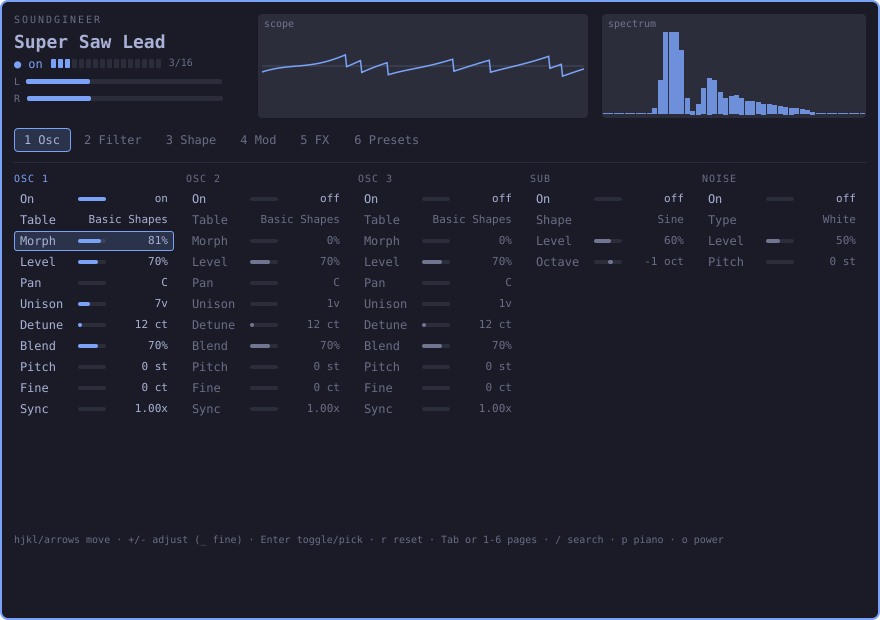
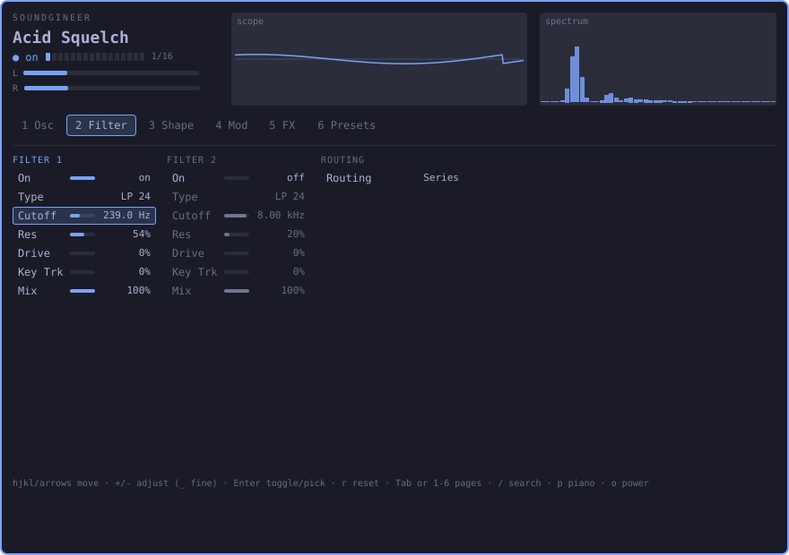
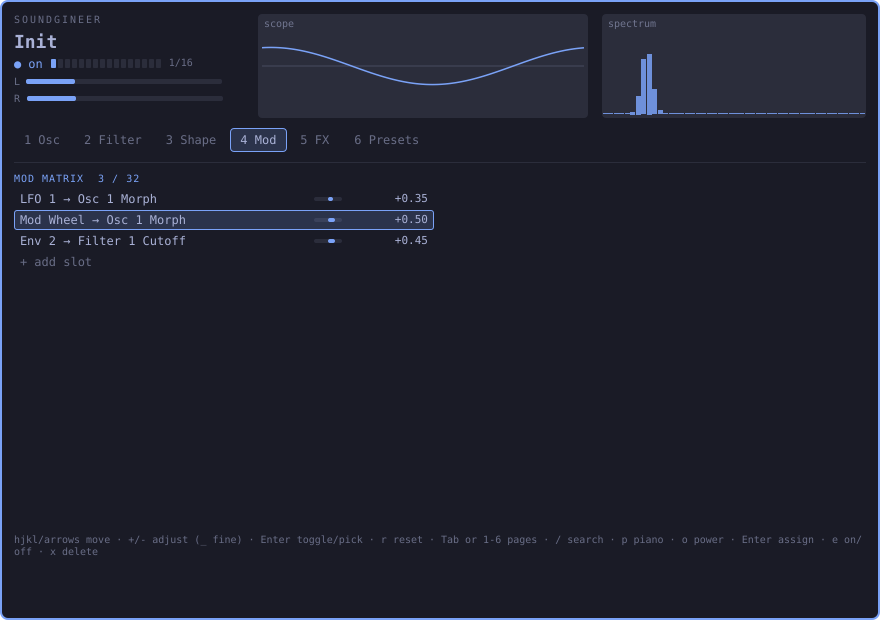
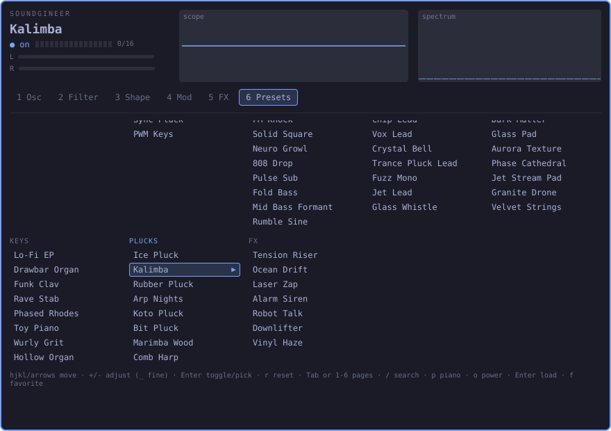
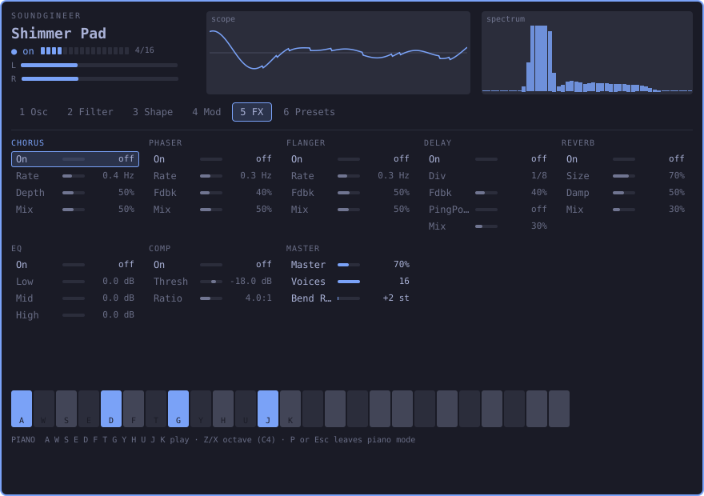
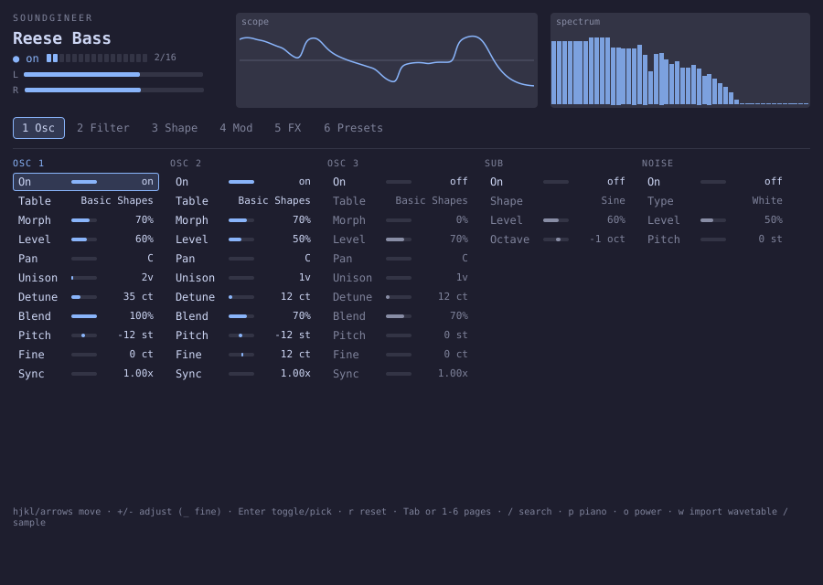

# Soundgineer for Omarchy

A wavetable synthesizer that lives in the Omarchy bar. A native C++ engine
plays through PipeWire and takes MIDI; a keyboard-first panel drops down from
the bar to edit it. The same DSP core also builds as VST3, LV2 and a
standalone app.



| | |
|---|---|
|  |  |
|  |  |

*Screenshots are rendered from `demo/` (mock engine, default Omarchy theme);
the bar popup shows the same panel in your current theme.*

## What it is

- **Sound:** a class-by-class port of the Soundgineer TypeScript synth that
  matches the original **bit for bit** on all 53 parity cases. It has
  3 wavetable oscillators (morph, up to 16-voice unison, hard sync), sub and
  noise oscillators, 2 filters (SVF, comb, formant) in series or parallel,
  a shape stage, 6 envelopes, 8 drawable LFOs, 4 macros, a 32-slot mod
  matrix, 8 effects and 59 factory presets.
- **Engine:** `soundgineer-engine`, a headless daemon. It uses the JACK API,
  which `pipewire-jack` provides on Omarchy, for audio out and MIDI in.
  It starts on demand through a systemd user socket. It has no network
  access: the unit restricts it to Unix sockets.
- **Bar widget:** shows a power ring, a voice dot, stereo peak bars and the
  patch name. Click it to open the panel; right-click toggles power.

## Install

You need Omarchy 4 and the build tools
(`sudo pacman -S --needed base-devel cmake ninja pipewire-jack`). Then:

```bash
omarchy plugin add https://github.com/noisyloop/omarchy-audio-synthesizer --enable
cd ~/.config/omarchy/plugins/noisyloop.soundgineer
./install.sh             # engine, Soundgineer app, sg-ctl, sg-render, presets, systemd units
./install.sh --plugins   # optional: also VST3 (~/.vst3), LV2 (~/.lv2), standalone
```

`install.sh` never uses sudo. It builds in `~/.cache/soundgineer` and installs
to `~/.local/bin`, `~/.local/share/soundgineer` and
`~/.local/share/systemd/user`. `./uninstall.sh` removes all of that and keeps
your presets. An AUR `PKGBUILD` is in `packaging/aur/`.

## Uninstall

```bash
cd ~/.config/omarchy/plugins/noisyloop.soundgineer
./uninstall.sh                              # engine, app, CLI tools, launcher entry, units, VST3/LV2
omarchy plugin remove noisyloop.soundgineer # the bar widget (deletes this folder, so run it last)
```

`uninstall.sh` stops `soundgineer.socket` and keeps your presets, favorites
and last session. To delete those too:

```bash
rm -rf ~/.local/share/soundgineer ~/.local/state/soundgineer
```

If you installed with the AUR package, run `sudo pacman -Rns soundgineer` instead
of `uninstall.sh`.

## Usage



**As an app:** open **Soundgineer** from the app launcher, or run
`soundgineer`. It is the same panel in a normal window, themed from your
current Omarchy theme. `Ctrl+Q` quits. The engine starts by itself on first
connect.

**From the bar:** open the panel from the bar widget, or bind
`omarchy-shell noisyloop.soundgineer toggle` to a key. Play it with a MIDI keyboard
(connected automatically) or with the computer keyboard in piano mode.

### Keyboard shortcuts

| Keys | Action |
|------|--------|
| `h j k l` / arrows | move between sections and rows |
| `+` / `-` | change the value; `_` (Shift+`-`) for a fine step down |
| `Enter` / `Space` | toggle on/off or step a choice, load a preset, assign a mod slot |
| `r` | reset the parameter to its default |
| `Tab` / `Shift+Tab` / `1`–`6` | pages: Osc · Filter · Shape · Mod · FX · Presets |
| `/` | search parameters and presets (type to filter, arrows, Enter) |
| `p` | piano mode: `A W S E D F T G Y H U J K` play C–C, `Z` / `X` octave, `P` or `Esc` leave |
| `w` | on an OSC section: pick a wavetable (built-in or WAV from `~/Music` / `~/.local/share/soundgineer/wavetables`); on NOISE: pick a sample |
| `o` | power on/off |
| `Esc` | close the panel (bar); in the window app `Ctrl+Q` quits |
| Mod page | `Enter` pick source → target, `e` slot on/off, `x` delete |
| Presets page | `Enter` load, `f` favorite |

Piano mode takes over the letter keys on purpose: `h j k` and `x` are
navigation keys otherwise.

### No sound?

Soundgineer plays to your **default output**, the same one other apps use.
It picks that up when the engine starts, whenever the app or bar panel opens,
and when you toggle power (`o`, or right-click the bar widget). If you switch
outputs while it's open, press `o` twice. To see where it's connected:
`pw-link -l | grep -A1 Soundgineer:out`.

### Finding presets

There are 59 factory presets in 7 groups: Starter, Bass, Leads, Pads, Keys,
Plucks and FX.

- Press `6` to open the Presets page. The groups are columns: `h` / `l` move
  between them, `j` / `k` move within one, and `Enter` loads.
- Or press `/` and type part of a name (for example `bass`), then `Enter`.
- From a terminal: `sg-ctl presets` lists them, and `sg-ctl load "Kalimba"`
  loads one.

The factory presets are built into the engine, so they can't go missing. If
the Presets page is empty, the panel isn't getting answers from the engine,
or an older engine is still running. Update, then restart it:

```bash
cd ~/.config/omarchy/plugins/noisyloop.soundgineer && git pull && ./install.sh
systemctl --user restart soundgineer.service
journalctl --user -u soundgineer | tail -3   # should say "59 factory presets built in"
```

### MIDI

Note on/off with velocity, pitch bend, mod wheel (CC 1), sustain (CC 64),
channel pressure, and CC 20–23 for macros 1–4.

### From a terminal

```bash
sg-ctl load "Kalimba"          # load a preset
sg-ctl note 60 0.9 0.5         # play middle C for half a second
sg-ctl param filter1.cutoff 0.4
sg-ctl save "My Pluck" Plucks  # -> ~/.local/share/soundgineer/presets/
sg-ctl watch 5                 # live status
sg-render --preset "Reese Bass" --midi riff.mid --out riff.wav   # offline render
```

### Try the panel without installing

```bash
qml demo/Main.qml
```

This runs the panel against a mock engine (no sound) with plain Qt. See
[`demo/README.md`](demo/README.md).

## Architecture

```
omarchy-shell (Quickshell / QML)
  plugin/Widget.qml   bar face + KeyboardPanel popup (one per monitor)
  plugin/ui/          the panel (shared with demo/)
  plugin/Service.qml  singleton, JSON lines over $XDG_RUNTIME_DIR/soundgineer.sock
app/ (soundgineer)    the same panel in a desktop window (Qt 6, QLocalSocket)
        │
        ▼  systemd --user soundgineer.socket (0600) starts …
soundgineer-engine  C++20 · JACK API (pipewire-jack) · lock-free queues
        │
engine/core  dependency-free DSP core, also used by
             sg-render (offline), and VST3 / LV2 / standalone (DPF)
```

More detail: [`docs/architecture.md`](docs/architecture.md), the protocol in
[`docs/protocol.md`](docs/protocol.md), and port decisions and parity results in
[`docs/porting-notes.md`](docs/porting-notes.md).

## Building from source

```bash
cmake -S . -B ~/.cache/soundgineer/dev -G Ninja -DCMAKE_BUILD_TYPE=Release
cmake --build ~/.cache/soundgineer/dev
ctest --test-dir ~/.cache/soundgineer/dev --output-on-failure
tools/omarchy-plugin-validate .
```

- Build outside the repository. When the repository is installed as an
  Omarchy plugin, the shell reloads the plugin on every file written inside
  it, so CMake refuses in-source builds.
- `-DSG_BUILD_PLUGINS=ON` adds VST3/LV2/standalone. It fetches DPF at a
  pinned commit; pass `-DFETCHCONTENT_SOURCE_DIR_DPF=…` to build offline.
- `ctest` runs the unit tests, the 59-preset load test and the parity suite:
  53 golden renders from the reference, compared with `sg-render --parity`.
- `sg-render --bench` measures CPU use. With 16 voices × 3 oscillators ×
  4-voice unison it uses **10.1 % of one core** on a 2.3 GHz Xeon cloud vCPU.
- Regenerating the golden files needs Node 22+ and a local reference checkout
  (dev only); see [`tests/parity/README.md`](tests/parity/README.md).

## Status and known gaps

- **Tested by people on Omarchy:**
  - the Soundgineer window app
  - live audio through PipeWire, playing to the default output
  - all 59 factory presets on the Presets page
  - reinstalling over an existing install with `./install.sh`
- Tested in the build environment: the engine, protocol and presets
  (`--dummy-audio` mode), the parity suite, `install.sh` / `uninstall.sh`, and
  VST3 and LV2 discovery in Carla.
- Not yet reported: MIDI hardware, and the bar widget inside omarchy-shell.
- No custom GUI in VST3/LV2; hosts show their generic parameter view. The 59
  factory presets are VST3 programs and LV2 presets, and the mod matrix, LFO
  shapes and FX order are saved with host sessions.
- Security: first-pass review in [`docs/security-review.md`](docs/security-review.md).

## Privacy

No telemetry, analytics, crash reporting, update checks, or network access
of any kind at runtime.

## License

MIT, see [`LICENSE`](LICENSE). Dependencies: the JACK API (pipewire-jack, MIT)
and DPF (ISC, plugin targets only).
